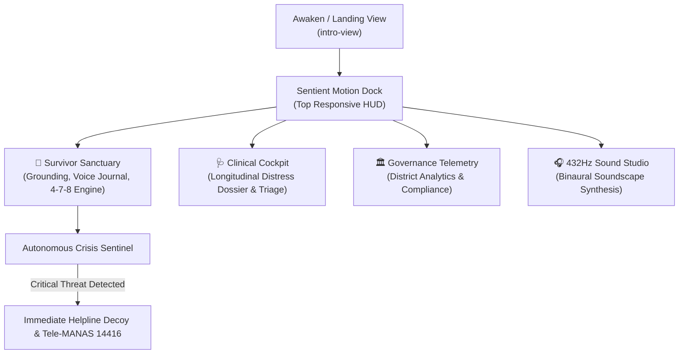

# AURAIS — Sentient Emotional Resilience & Distress Triage System

**AURAIS** (pronounced *aw-RAY-iss*, from *Aura* + *Aegis*) is an autonomous, sentient mental-health monitoring and crisis-intervention platform. Engineered by **Harshit Raj** as a production-grade personal project.

> 🌐 **Production Vercel**: [https://aurais-ai.vercel.app](https://aurais-ai.vercel.app)  
> 🌍 **GitHub Pages Mirror**: [https://harshitraj0073-star.github.io/AURAIS/](https://harshitraj0073-star.github.io/AURAIS/)  
> 💻 **Local Development**: `python3 -m http.server 3000` -> [http://localhost:3000](http://localhost:3000)  
> 📂 **Repository**: [https://github.com/harshitraj0073-star/AURAIS](https://github.com/harshitraj0073-star/AURAIS)

---

## 💡 The Story
Originally conceived during a Smart India Hackathon problem space, the early team prototype was simple and fell short. Rather than letting the idea die, Harshit took full ownership, went back to first principles, and rebuilt the entire platform from the ground up as a solo engineer — integrating living ambient canvas shaders, real-time acoustic vocal biomarker analysis, multi-channel triage telemetry, and localized multi-language AI companions.

---

## 🏛️ Interactive System Flow

---

## ✨ System Architecture & Highlights

- **Universal Ambient Shader Studio** — 10 switchable, hardware-accelerated canvas background engines (*Sentient Aura, Neural Synapse, Fluid Smoke, Aurora Borealis, Dot Matrix, Noise Gradient, Deep Field, Matrix Rain, Retro Neon Grid, Warp Drive*) with zero CPU choke.
- **Acoustic Biomarker Analysis** — Real-time vocal pitch jitter, micro-shimmer, and tremor frequency tracking for immediate physiological distress classification.
- **Autonomous Crisis Detection** — Multi-tiered risk triage (`stable`, `moderate`, `critical`) that automatically surfaces de-escalation protocols and emergency helplines upon detecting intimidation or acute distress.
- **Synchronized 4-7-8 Breathing Engine** — Interactive sonar ripples with haptic sound synthesis, phase progression chips, and reward triggers.
- **Offline-First PWA**: Fully functional offline through a dedicated service worker (`aurais-v1`) and web manifest.

---

## 🧭 Multi-Role Cockpits (Direct UI Switching)

Visitors can switch between all 4 perspectives instantly via the **top responsive motion dock** on both desktop and mobile:

| Cockpit | Dock Icon | Primary Focus |
| :--- | :---: | :--- |
| **Survivor Sanctuary** | 🌿 | Private check-ins, acoustic journal, grounding exercises, and empathetic companion |
| **Clinical Cockpit** | 🩺 | Longitudinal patient distress tracking, radar diagnostics, and AI clinical triage |
| **Governance Telemetry** | 🏛️ | District-level distress heatmaps, compensation disbursement velocity, and statutory compliance reporting |
| **432Hz Soundscape** | 🎧 | Binaural frequency generator with harmonic alpha/theta wave stabilization |

---

## 🛠 Tech Stack

- **Frontend Core**: Vanilla HTML5, CSS3 Glassmorphism System, High-Performance Canvas 2D / WebGL Engines.
- **Frameworks & Libs**: Tailwind CSS, Chart.js, Web Audio API Synthesizer, Web Speech Synthesis & Recognition API.
- **AI Core**: Empathetic multi-turn conversational engine with optional Google Gemini Flash API integration.
- **Localization**: Native English, Hindi (हिंदी), and Marathi (मराठी).
- **Deployment**: Zero-dependency GitHub Pages edge deployment.

---

## 👤 Author

**Harshit Raj**  
B.Tech Computer Science & Engineering, Ajeenkya DY Patil University (ADYPU), Pune  
GitHub: [@harshitraj0073-star](https://github.com/harshitraj0073-star)
